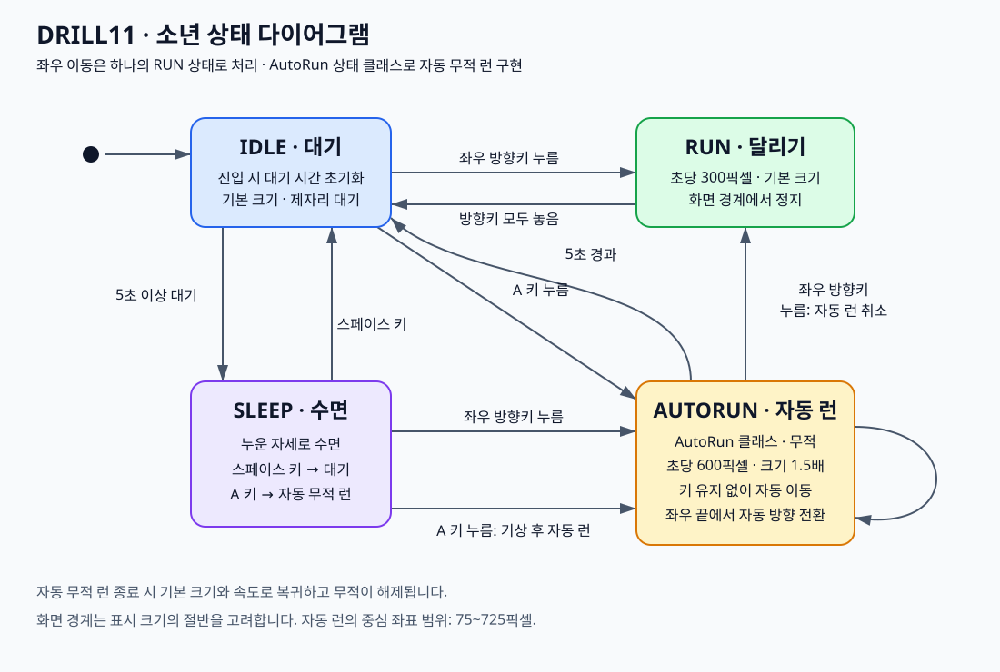

# DRILL11 — 자동 무적 런

공개 저장소: [junsuk1211/DRILL11](https://github.com/junsuk1211/DRILL11)

## 실행

```powershell
python -m pip install -r requirements.txt
python main.py
```

Python 3.10 이상이 필요합니다. `main.py` 위치를 기준으로 이미지를 불러오므로 다른 폴더에서도 실행할 수 있습니다.

## 조작과 동작

| 상태 | 입력 또는 조건 | 결과 |
| --- | --- | --- |
| IDLE | A | AUTORUN 시작 |
| IDLE / SLEEP | 좌우 방향키 누름 | 해당 방향 RUN |
| RUN | 방향키 모두 놓음 | IDLE |
| IDLE | 5초 이상 대기 | SLEEP |
| SLEEP | Space | IDLE |
| AUTORUN | 5초 경과 | IDLE, 대기 타이머 초기화 |
| AUTORUN | 좌우 방향키 누름 | 자동 런 취소 후 해당 방향 RUN |

`autorun.py`의 **AutoRun 클래스**가 진입, 종료, 갱신, 그리기를 담당합니다.
`boy.py`의 transitions 상태 기계가 이 클래스의 동작을 호출합니다.
자동 런은 시작할 때 바라보던 방향으로 출발하고, 키를 누르지 않아도 이동합니다.
속도는 일반 RUN의 300 px/s에서 **600 px/s**로, 크기는 100×100에서 **150×150**으로 커집니다.
확대 크기를 고려해 좌우 경계에서 자동 반사하며 프레임이 늦어져도 이동량을 보존합니다.
종료 또는 취소 즉시 기본 속도와 크기로 돌아오고 `boy.invincible`도 False가 됩니다.
현재 프로젝트에는 적이나 피격 기능이 없으므로 무적 여부는 상태 속성으로 제공합니다.
자동 런 중 A를 다시 눌러도 제한 시간이 연장되지 않습니다.
양쪽 방향키를 누르면 마지막으로 누른 방향을 따르고, 하나를 놓으면 남은 방향으로 달립니다.

## 상태 그림



[Mermaid 원본](state_diagram.mmd) · [SVG 원본](state_diagram.svg)

## 검증

```powershell
python -B -m unittest -v test_states
```

그래픽 창 없이 시간을 제어해 경계 반사, 크기, 가속, 5초 종료, 방향키 취소,
IDLE 타이머 재시작과 기존 IDLE/RUN/SLEEP 동작을 검증합니다.

## 개발 이력

이 폴더는 독립 Git 저장소입니다. 기능, 테스트, 다이어그램을 단계별로 커밋합니다.

```powershell
git log --oneline --reverse
```

이미지와 기존 IDLE/RUN/SLEEP 동작의 출처: 상위 프로젝트 `Labs/LEC12_CharacterController`.
